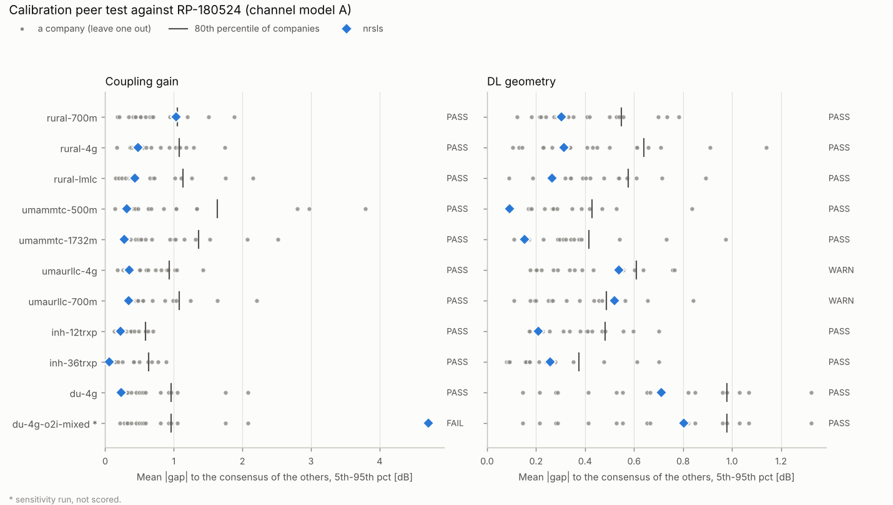

# Benchmark suite: is the nrsls system-level evaluation aligned with other companies?

This benchmark answers one question with numbers: **would nrsls look like just another participating company in the 3GPP campaigns that every company's simulator was checked against?** It uses only reference data that is in the repository, so it runs offline, and it gives a PASS / WARN / FAIL verdict per check.

```bash
python examples/benchmark.py                 # tier 1 (~3 min on 4 cores) + tier 2 from the last run
python examples/benchmark.py --e2e           # also rerun tier 2 (~27 min)
python examples/benchmark.py --tier 1 --cases du-4g,umaurllc-4g --drops 10
python -m pytest tests/test_benchmark.py     # the criteria logic and the beam model, ~2 s
```

It writes `results/benchmark.json`, the scorecard `results/benchmark.md` and the figure `results/benchmark_calibration.png`. The exit code is 1 if a scored check fails, so it can gate a merge.

## The tiers

| Tier | What it checks | Reference (companies) | Status |
|---|---|---|---|
| 1. Large-scale calibration | Coupling gain and DL geometry CDFs of every IMT-2020 configuration nrsls can set up | RP-180524 per-company curves (15–18 per configuration, 21 companies in all), the data behind TR 37.910 Annex A | **10 configurations**, implemented and run |
| 2. End-to-end spectral efficiency | Full-buffer MU-MIMO average and 5th-percentile SE | TR 37.910 §5.4.1 company averages (7–11 per case) | Dense Urban config A implemented ([validation-du-a.md](validation-du-a.md)); 5 more cases specified below |
| 3. Internal consistency | Properties that need no external reference | – | partly in place (LLS ↔ SLS regression, CSI and MU monotonicity, BLER target) |
| 4. CW2L cross-company | The 6GR CW2L template results against the other companies' columns | the filled 6GR template, once collected | specified below |

Each tier tests something the tier above cannot. Tier 1 isolates the layout, propagation, antenna and attachment from everything else. Tier 2 adds CSI, scheduling, link adaptation and overhead, but its reference is an average without its spread. Tiers 3 and 4 cover what has no published industry reference yet.

## Tier 1: peer test against the RP-180524 companies

### Method

RP-180524 collected each company's coupling-gain and geometry CDF per configuration. The benchmark treats nrsls as company n + 1:

1. Every curve is read at the 5th, 10th, ..., 95th percentiles (19 points). The extreme tails are left out because a few hundred UTs per company make them noisy.
2. **A company's deviation** is the mean absolute gap between its curve and the mean of the *other* companies (leave one out), in dB.
3. **nrsls' deviation** is the mean absolute gap between its curve and the mean of all the companies. It is the same quantity: distance from the consensus of everybody else.
4. The companies' deviations set the tolerance. **PASS** means nrsls is within the 80th percentile of the companies' deviations, and at least 80 % of its percentiles lie inside the companies' min–max envelope. **WARN** means it is within the largest company deviation, or the envelope share is 60–80 %. **FAIL** means it is further from the consensus than every company. A configuration passes if both metrics pass.

Why not a fixed "within 1 dB"? The companies agree to very different degrees: their median deviation is 0.2–0.9 dB, and their largest is 0.7 dB for Indoor Hotspot geometry but 3.8 dB for UMa mMTC coupling gain. A fixed tolerance would be too loose for Indoor Hotspot and too strict for mMTC. Ranking nrsls among the companies also says how typical it is: "rank 3 of 17" means only 2 companies sit closer to the consensus.

Each configuration runs 20 drops, seed 1, and channel model A only. Channel model B is the alternative ITU-R model, which nrsls does not implement.

### New: the Dense Urban config A calibration

Phase 2 ([calibration-p2.md](calibration-p2.md)) skipped Dense Urban config A because its calibration uses analog beams. That left `du-a`, the scenario behind the TR 37.910 validation and every CW2L study, without its own calibration check. The benchmark adds a beam-set calibration mode (`ScenarioConfig.calib_beams`, preset `rp-du-4g`) that follows RP-180524 Table 2:

- **Sub-arrays:** 128 elements (8, 8, 2) at dH = 0.5λ, dV = 0.8λ, and 4 TXRUs. Each TXRU is a 4 × 8 co-polarised sub-array with the 2-D DFT weights of RP-180524 Appendix 1, peaking at K·L = 32 on its beam.
- **Beam set:** 12 beams, at LCS zenith 5π/8 and 7π/8 and azimuth ±π/16, ±3π/16, ±5π/16.
- **Attachment and coupling gain:** the UT attaches on the port-0 RSRP of its best beam, and the coupling gain uses that beam.
- **Geometry:** every interfering TRxP uses a random beam, drawn per link.

The beam array factor is a real per-ray power factor shared by both polarisations, so it multiplies the TR 36.873 eq. (8.1-1) ray gains directly (`link/rsrp.py: multipath_beam_gains`).

### Result (20 drops, commit with this file)



| Configuration | Coupling gain: deviation, rank, envelope | Geometry: deviation, rank, envelope | Verdict |
|---|---|---|---|
| Rural 700 MHz | 1.04 dB (p80 1.05), 14 / 19, 84 % | 0.30 dB (p80 0.55), 8 / 19, 100 % | PASS |
| Rural 4 GHz | 0.47 dB (p80 1.08), 6 / 19, 100 % | 0.31 dB (p80 0.64), 7 / 19, 95 % | PASS |
| Rural LMLC | 0.44 dB (p80 1.14), 8 / 16, 100 % | 0.27 dB (p80 0.58), 3 / 16, 100 % | PASS |
| UMa mMTC 500 m | 0.32 dB (p80 1.63), 2 / 16, 100 % | 0.09 dB (p80 0.43), 2 / 16, 100 % | PASS |
| UMa mMTC 1732 m | 0.28 dB (p80 1.36), 1 / 16, 100 % | 0.15 dB (p80 0.42), 3 / 16, 100 % | PASS |
| UMa URLLC 4 GHz | 0.35 dB (p80 0.93), 5 / 16, 95 % | 0.54 dB (p80 0.61), 11 / 16, **79 %** | **WARN** |
| UMa URLLC 700 MHz | 0.34 dB (p80 1.08), 3 / 16, 100 % | **0.52 dB (p80 0.49)**, 13 / 16, 95 % | **WARN** |
| Indoor Hotspot 12 TRxP | 0.22 dB (p80 0.59), 4 / 17, 100 % | 0.21 dB (p80 0.48), 3 / 17, 100 % | PASS |
| Indoor Hotspot 36 TRxP | 0.06 dB (p80 0.64), 1 / 16, 100 % | 0.26 dB (p80 0.38), 11 / 16, 100 % | PASS |
| **Dense Urban 4 GHz** (new) | 0.23 dB (p80 0.96), 2 / 17, 100 % | 0.71 dB (p80 0.98), 10 / 17, 100 % | PASS |
| Dense Urban 4 GHz, 20/80 building mix (not scored) | **4.71 dB**, 17 / 17, 0 % | 0.80 dB, 10 / 17, 84 % | FAIL |

"p80" is the 80th percentile of the companies' deviations, the PASS threshold. The gaps per percentile are in `results/benchmark.md`.

**Overall: WARN.** 8 of the 10 scored configurations pass on both metrics, and the 2 warnings are on geometry only.

### What the result says

- **nrsls sits inside the industry on every configuration.** No scored check is further from the consensus than every company. In coupling gain, nrsls is among the 6 closest participants in 8 of 10 configurations.
- **The Dense Urban config A propagation is calibrated.** Its coupling gain ranks 2nd of 17. Its geometry is 0.3–0.9 dB below the company mean (the largest single gap is −1.0 dB), but ranks 10th of 17 with every percentile inside the envelope. This is the check `du-a` was missing.
- **UMa URLLC geometry is consistently about 0.5 dB low.** It sits 0.2–0.9 dB below the mean, most at the 50th–95th percentiles, at both 4 GHz and 700 MHz. Phase 2 reported the same offset, so it is not a regression. The two UMa mMTC configurations share the pathloss and LSPs and pass with deviations of 0.09–0.15 dB. URLLC differs from them in having 80 % outdoor UTs, so the likely cause is in the outdoor LOS links: K-factor, LOS ray, or sector leakage near boresight. Not resolved yet.
- **The `du-a` preset uses the wrong building-loss model for channel model A.** `du-a` draws 20 % high-loss and 80 % low-loss buildings. ITU-R M.2412 Table A1-7 specifies, for channel model A at or below 6 GHz, a fixed 20 dB wall loss plus 0.5 d2D-in (UMa_A, UMi_A). The 20/80 mix belongs to channel model B (Table A1-8) or to model A above 6 GHz, and RP-180524 says so ("applies to channel model B"). With the 20/80 mix the Dense Urban coupling gain is 1–6 dB too high and ranks last of 17; with the M.2412 model it ranks 2nd. Geometry hardly moves (0.71 against 0.80 dB), because 200 m ISD is interference-limited: building loss scales serving and interfering power alike. So the CW2L gains, which depend on SINR, are probably unaffected. Absolute spectral efficiencies and UPTs may shift by a few per cent; the earlier decomposition saw +4 % SE with the legacy model ([benchmark-tr37910.md](benchmark-tr37910.md)). **Recommendation:** switch `du-a` to `o2i_model="legacy"` and rerun tier 2. Whether to rerun the CW2L studies is a separate decision.

## Tier 2: end-to-end spectral efficiency against TR 37.910

### Implemented: Dense Urban config A

`nrsls.validation.du_a`, run by `examples/validate_du_a.py` or by `benchmark.py --e2e`. It compares eType-II MU-MIMO with the TR 37.910 11-company Type II average, 11.04 / 0.37 bit/s/Hz:

- **V1–V2:** within ±15 %.
- **V3:** an ideal-CSI bound at least 0.95 × the reference.
- **V4:** ideal CSI beats eType-II.
- **V5:** the ITU-R requirement is met.
- **V6:** first-transmission BLER within 0.07–0.13.
- **V7:** MU-MIMO is exercised.

Last result: **PASS 7/7**, with eType-II at 9.77 (−11.5 %) and 0.358 (−3.2 %).

The ±15 % tolerance is the weak spot of this tier. TR 37.910 publishes only the company average, without the spread. 15 % is about ±1 dB of SINR at these spectral efficiencies, the companies' spread in tier 1. If the per-company SE values from the TR 37.910 attachments become available, tier 2 should switch to the same peer test.

### Specified next: five more TR 37.910 cases

All are NR FDD at 10 MHz and 15 kHz, channel model A, MU-MIMO with the Type II codebook, which is the configuration with the most companies in each table:

| Case | TR 37.910 table | Antenna | Companies | Average SE | 5th pct | ITU-R requirement |
|---|---|---|---|---|---|---|
| Dense Urban config A (done) | 5.4.1.2.1-1(a) | 32×4, (8,8,2,1,1;2,8) | 11 | 11.04 | 0.37 | 7.8 / 0.225 |
| Indoor Hotspot config A, 12 TRxP | 5.4.1.1.1-1(a) | 32×4, (4,4,2,1,1;4,4) | 10 | 10.95 | 0.36 | 9 / 0.3 |
| Rural config A, 700 MHz | 5.4.1.3.1-1(a) | 8×2, (8,4,2,1,1;1,4) | 9 | 5.92 | 0.16 | 3.3 / 0.12 |
| Rural config C, LMLC | 5.4.1.3.3-1(a) | 8×4, (8,4,2,1,1;1,4) | 8 | 7.81 | 0.21 | 3.3 (average) |
| Indoor Hotspot config A, 36 TRxP | 5.4.1.1.1-2(a) | 32×4, (8,16,2,1,1;2,8) | 7 | 12.24 | 0.36 | 9 / 0.3 |
| Rural config B, 4 GHz | 5.4.1.3.2-1(a) | 32×4, (8,8,2,1,1;2,8) | 7 | 12.50 | 0.44 | 3.3 / 0.12 |

Each case reuses the tier-1 preset of the same configuration, so its propagation is already calibrated. It adds the M.2412 evaluation parameters: UT counts and speeds (Rural: 120 km/h in car), 32 or 8 TXRUs, the UT antenna and the overhead. The V1–V7 criteria apply unchanged.

The cases differ in what they exercise:
- **Rural 120 km/h:** stresses CSI ageing.
- **Indoor Hotspot:** noise-free, LOS-rich.
- **Rural 700 MHz with 8 TXRUs:** few antennas.

A case costs about 15–30 min on 4 cores.

## Tier 3: internal consistency

These checks need no industry reference but catch drift and modelling errors between benchmark runs:

| Check | Where | Status |
|---|---|---|
| One SLS link reproduces the link-level simulator within 2.5 % SE (CDL-A/C/D, 4T2R–32T4R, −5–30 dB) | `tests/test_lls_regression.py` | in place |
| Better CSI never performs worse (ideal > eType-II > Type I) | tier 2 V4 | in place (ideal vs eType-II) |
| Link adaptation holds its target (first-transmission BLER 0.07–0.13 with converged OLLA) | tier 2 V6 | in place |
| Wrap-around: the centre and the outer ring have the same geometry distribution | `tests/test_drop.py` | in place |
| Reproducibility: same seed, same result; serial and parallel runs agree | `tests/test_drop.py`, `tests/test_fullbuffer.py` | in place |
| Ideal (SVD) precoding not worse than Type I in the system loop | `tests/test_fullbuffer.py` | in place |
| Proposed: frozen CW2L baselines (NR UPT at 20 / 50 / 70 % RU, NR rank and BLER) with a tolerance band, so an engine change that moves them is noticed | – | proposed |
| Proposed: SE ≤ Shannon on the geometry, and RU increases with the FTP arrival rate | – | proposed |

## Tier 4: CW2L results against the other companies (when available)

The 6GR CW2L template is itself a cross-company benchmark in the making: every company fills its column with the same metrics, the mean, 5th- and 95th-percentile UPT gains at 20 / 50 / 70 % RU. Once the collected template is available, the tier-1 peer test applies directly. For each cell (precoding block, alternative, load, metric), compare nrsls' gain with the spread of the other companies' gains: nrsls' leave-one-out rank and whether it lies inside their envelope. That is the only reference for the CW2L conclusions themselves; tiers 1–3 validate the platform they run on.

## Limits

- **Large scale only in tier 1.** Tier 1 shows that layout, propagation, antennas and attachment match the industry. It does not test CSI, scheduling, link adaptation or traffic. Tier 2 does, but only against averages.
- **Channel model A only.** Channel model B (ITU-R) and the FR2 configurations with analog beams (Indoor Hotspot 30/70 GHz, Dense Urban 30 GHz) are not implemented. Their reference data is in `refs/rp180524/`.
- **The `du-a` system preset is not the calibration set-up.** The calibration uses 4 TXRUs with analog beams; the system studies use 32 digital TXRUs. Tier 1 therefore validates the propagation and geometry that `du-a` shares with the calibration (UMa model, layout, power, UTs), not its antenna virtualisation. The building-loss model is the one difference found that the system preset can fix.
