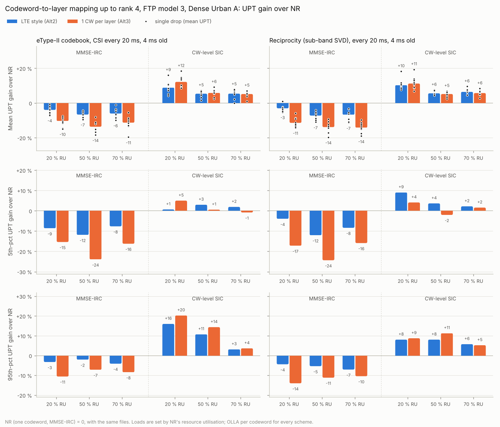

# Codeword-to-layer mapping up to rank 4 with FTP traffic: 20 MHz, 30 kHz, 44 dBm

This repeats the FTP study of [cw2lm-ftp.md](cw2lm-ftp.md) with a different carrier: 20 MHz and 30 kHz SCS, at M.2412's 44 dBm, with 10 drops instead of 5. The results filled a second copy of the 6GR CW2L template, `6GR_DL_CW2L_template_v003_20MHz_44dBm.xlsx` (sheet "SLS rank 1-4"), until 2026-11-08. The 10 MHz copy, `6GR_DL_CW2L_template_v003.xlsx`, is unchanged.

**Template, 2026-11-08.** The 20 MHz copy now holds the FTP model 1 evaluation with OLLA warm + fast start, not the FTP model 3 numbers on this page:
- **Columns:** D = MMSE-IRC, E = codeword-level SIC, and a new F = MMSE-IRC with Alt2 = twisted LTE (rank 4 split as 1 + 3 layers).
- **Blocks:** the "Reciprocity based precoding" rows hold sub-band SVD and "Other precoding scheme" wideband SVD; the codebook blocks are empty.
- **Sources:** tables in [results/cw2lm_ftp1_warmfast_20mhz.md](../results/cw2lm_ftp1_warmfast_20mhz.md), filled by `examples/fill_cw2l_template_ftp1.py`.

**Hand grip, 2026-11-09.** The FTP model 1 warm + fast set was rerun with the users' hand grip. The model is the UT self-blocking of TR 38.901 §7.6.4.1, blockage model A without the non-self blockers (`ue_self_blocking=True`).
- **Model:** each UT is held in portrait mode (one hand) or landscape mode (two hands), half and half. Its random azimuth orientation also turns its array. A cluster whose centre arrives in the grip's region of Table 7.6.4.1-1 loses 30 dB, and so does the LOS ray when it arrives there. In-car UTs are held like the others.
- **Runs:** the arrival rates were recalibrated with the grip, then the full set reran: 360 runs, 10 drops. An extra 80 NR runs at the no-grip rates separate the array orientation from the blocking. The tables are in [results/cw2lm_ftp1_grip_20mhz.md](../results/cw2lm_ftp1_grip_20mhz.md), whose script, `examples/cw2lm_ftp1_grip_compare.py`, lists the commands.
- **What the grip does to a drop:**
  - **Blocking:** it blocks 25 % of the serving link's clusters, which carry 26 % of its multipath power on average.
  - **Re-attachment:** 19 % of the UTs change cell. Their strongest cell is then 1.1 dB weaker at the median, 2.4 dB on average and 6.5 dB at the 90th percentile.
  - **Interference:** the grip blocks interferers too, so the full-load geometry rises by 0.1–0.2 dB in mean and median. The 200 m layout is interference-limited.
- **NR:**
  - **Rates:** the same RU takes 2–4 % more arrivals with the grip.
  - **Same rates:** at the no-grip rates, NR's mean UPT changes by +0.1 to +2.0 %. The array orientation alone accounts for −0.5 to +1.5 % and the blocking for −0.8 to +2.4 %.
  - **Rank:** NR's mean rank changes by at most 0.03.
- **The CW2L comparison does not change:**
  - **MMSE-IRC:** LTE style, twisted LTE and one codeword per layer are within −0.7 to +1.6 % of NR in mean UPT, against −1.4 to +2.3 % without the grip.
  - **SIC:** LTE style and one codeword per layer gain +9.3 to +13.0 %, against +8.3 to +12.4 %. All 120 single-drop gains with SIC are positive, with and without the grip.
  - **Shifts:** each mean gain moves by −0.7 to +2.1 points, and each 5th-percentile gain by −3.0 to +3.8.
- **Limits:**
  - **95th percentile at 20 % RU:** it sits at the peak rate (about 250 Mbit/s) and swings with the share of files that reach it, so its gains there are not meaningful.
  - **Interference-limited layout:** in a noise-limited deployment the grip's power loss would weigh more.
  - **Template:** the template copy still holds the no-grip set.

| | 10 MHz study ([cw2lm-ftp.md](cw2lm-ftp.md)) | This study (`--setup 20mhz`) |
|---|---|---|
| Carrier | 4 GHz FDD, 15 kHz SCS, 52 PRB, 10 MHz | 4 GHz FDD, 30 kHz SCS, 52 PRB, 20 MHz channel |
| BS power | 41 dBm (M.2412's 44 dBm per 20 MHz, scaled to 10 MHz) | 44 dBm |
| Slot | 1 ms | 0.5 ms |
| CSI period / delay, channel update | 20 / 4 slots, 2 slots (20 ms, 4 ms, 2 ms) | 40 / 8 slots, 4 slots (the same times) |
| HARQ round trip | 8 slots = 8 ms | 8 slots = 4 ms |
| Run | 2300 slots = 2.3 s (0.3 s warm-up, last 0.5 s not counted) | 2300 slots = 1.15 s (0.15 s warm-up, last 0.25 s not counted) |
| Drops | 5 | 10 |
| Load calibration | 900-slot NR runs on drop 0 | full-length NR runs on drops 0 and 1, 6 rates per case |
| Measured NR RU at the 20 / 50 / 70 % loads | 18 / 55 / 78 % (eType-II), 19 / 54 / 78 % (SVD) | 21 / 51 / 71 % (both) |

Everything else is the same: Dense Urban-eMBB A, 32T and 4R, rank ≤ 4, eType-II and reciprocity-based (sub-band SVD) precoding, MMSE-IRC and codeword-level SIC with plain per-codeword OLLA, 0.5 Mbyte files, 4-PRB RBGs and sub-bands.

**Building loss.** These runs used the building-loss model `du-a` had at the time: 20 % high-loss / 80 % low-loss buildings, which ITU-R M.2412 assigns to channel model B. Since 2026-11-03 `du-a` uses the channel-model-A loss (20 dB + 0.5 d2D-in), and the study scripts pin the former mix (`DU_A_MIXED_O2I`) so the results here stay reproducible. In the Dense Urban calibration the two models differ by 2–6 dB in coupling gain but only 0–0.3 dB in geometry, because the 200 m layout is interference-limited ([benchmark-suite.md](benchmark-suite.md)). The relative gains are therefore not expected to change; absolute UPTs may shift slightly.

**Why the run is the same in slots.** The power per Hz is the same as before: 44 dBm over 18.7 MHz against 41 dBm over 9.4 MHz. So the SINRs barely change.
- **Twice as fast:** a 0.5 ms slot carries about as many bits as a 1 ms slot did, so the system moves twice as fast. The arrival rates for the same RU are about twice the 10 MHz ones, and a file is served in about half the time.
- **Same statistics per drop:** a run of the same number of slots therefore sees about as many files, and as many transmissions per UE, as before. That gives the same statistics per drop at half the simulated time.
- **Faster runs:** a 30 kHz slot is also cheaper to simulate, because CSI and channel updates come every 40 and 4 slots instead of 20 and 2. A run took 11–27 min.

## Result



- **With MMSE-IRC, NR's single codeword is still the best of the three at every load and percentile.**
  - LTE style loses 3–7 % mean UPT, 4–12 % at the 5th percentile and 2–7 % at the 95th.
  - One codeword per layer loses 10–14 % mean UPT, 15–24 % at the 5th percentile and 7–14 % at the 95th.
  - Of the 120 single-drop mean gains with MMSE-IRC, 118 are negative. The other two are LTE style with SVD at 20 % RU, which spans −5 to +1 %.
- **With codeword-level SIC, both multi-codeword mappings gain at every load.**
  - LTE style gains 5–10 % mean UPT, +1 to +9 % at the 5th percentile and +3 to +16 % at the 95th.
  - One codeword per layer gains 5–12 % mean UPT, −2 to +5 % at the 5th percentile and +4 to +20 % at the 95th.
  - 119 of the 120 single-drop mean gains are positive. The exception is one LTE-style drop at 70 % RU with eType-II, at −0.01 %, which is zero.
  - The gain is largest at 20 % RU (+9 to +12 %).
- **LTE style versus one codeword per layer with SIC.** In mean UPT they are within a point of each other, except at 20 % RU, where one codeword per layer is ahead by 1–3 points. LTE style is ahead at the 5th percentile in five of the six cases. One codeword per layer is ahead at the 95th percentile in five of the six. With MMSE-IRC, one codeword per layer loses 2–4 times as much as LTE style. LTE style also needs signalling for two codewords instead of four.

The conclusion of the 10 MHz study holds:
- **MMSE-IRC:** keep NR's single codeword.
- **Codeword-level SIC:** a two-codeword LTE-style split gives +5 to +10 % mean UPT and +1 to +9 % at the cell edge.
- **One codeword per layer:** it adds nothing over LTE style beyond the low-load mean and the top users.

### What changed against 10 MHz

| Mean UPT gain over NR, 10 MHz → 20 MHz | eType-II 20 / 50 / 70 % RU | SVD 20 / 50 / 70 % RU |
|---|---|---|
| MMSE-IRC, LTE style | −5.7 / −9.1 / −7.9 → −4.0 / −6.7 / −6.1 | −5.7 / −9.9 / −7.8 → −3.0 / −7.2 / −6.8 |
| MMSE-IRC, 1 CW per layer | −14.7 / −17.2 / −17.0 → −10.4 / −13.7 / −11.3 | −14.5 / −20.5 / −17.6 → −11.4 / −13.9 / −14.2 |
| SIC, LTE style | +8.8 / +4.6 / +5.2 → +8.9 / +5.4 / +5.4 | +6.5 / +4.1 / +5.8 → +10.3 / +5.6 / +6.5 |
| SIC, 1 CW per layer | +10.5 / +2.6 / +4.9 → +12.2 / +5.9 / +5.2 | +7.6 / +1.1 / +3.7 → +11.2 / +5.2 / +5.7 |

The MMSE-IRC losses are 1–7 points smaller, and the SIC gains are 0–4 points larger. Two differences in the runs point the same way:

- **The upper loads are lower.** At 10 MHz the "50 %" and "70 %" points ran at 54–55 % and 78 % RU. Here they run at 51 % and 71 %, so there is less queueing to turn extra resource use into lost UPT.
- **Rank 4 is rarer.** NR's rank-4 share at 20 % RU drops from 23 % to 15 % (eType-II) and from 37 % to 27 % (SVD), and its mean rank from 2.83 to 2.63 and from 3.09 to 2.94. Fewer transmissions carry four codewords, so one codeword per layer loses less with MMSE-IRC. At 20 % RU it needs 12–15 % more resources than NR for the same files, against 20 % at 10 MHz. The likely cause is the 30 kHz PRB: a 4-PRB sub-band is 1.44 MHz wide instead of 0.72 MHz, so one sub-band precoder has to cover more frequency selectivity, which hurts the weakest layers most. This study does not separate that from other numerology effects, such as the 4 ms HARQ round trip.

### Limits

- **Open files.** At the 70 % point, 6–11 % of the counted files are still open at the end, with an upper-bound UPT. MMSE-IRC with more codewords has the most open files, so its losses there are, if anything, understated.
- **PRB count.** 52 PRB at 30 kHz is 18.72 MHz. TS 38.101-1 allows 51 PRB in a 20 MHz channel at 30 kHz; 52 keeps the PRB count of the 10 MHz study.
- **Other assumptions.** These are as in [cw2lm-ftp.md](cw2lm-ftp.md): ideal channel estimation, MIESM, SU-MIMO only, and plain OLLA for SIC.

## Detailed results

### Gains over NR

**eType-II codebook**, gain in % over NR (mean / 5th pct / 95th pct UPT):

| Receiver | Scheme | 20 % RU: mean | 5th | 95th | 50 % RU: mean | 5th | 95th | 70 % RU: mean | 5th | 95th |
|---|---|---|---|---|---|---|---|---|---|---|
| MMSE-IRC | LTE style (Alt2) | **−4.0** | −8.6 | −3.3 | **−6.7** | −11.9 | −2.1 | **−6.1** | −7.7 | −4.1 |
| MMSE-IRC | 1 CW per layer (Alt3) | **−10.4** | −15.4 | −10.6 | **−13.7** | −24.0 | −7.2 | **−11.3** | −16.2 | −8.4 |
| CW-level SIC | LTE style (Alt2) | **+8.9** | +0.7 | +16.0 | **+5.4** | +3.0 | +10.7 | **+5.4** | +1.9 | +3.2 |
| CW-level SIC | 1 CW per layer (Alt3) | **+12.2** | +5.0 | +20.3 | **+5.9** | +0.6 | +14.3 | **+5.2** | −0.8 | +3.7 |

**Reciprocity (sub-band SVD)**, gain in % over NR (mean / 5th pct / 95th pct UPT):

| Receiver | Scheme | 20 % RU: mean | 5th | 95th | 50 % RU: mean | 5th | 95th | 70 % RU: mean | 5th | 95th |
|---|---|---|---|---|---|---|---|---|---|---|
| MMSE-IRC | LTE style (Alt2) | **−3.0** | −4.0 | −4.4 | **−7.2** | −12.1 | −5.4 | **−6.8** | −8.4 | −7.1 |
| MMSE-IRC | 1 CW per layer (Alt3) | **−11.4** | −17.2 | −14.0 | **−13.9** | −24.4 | −11.2 | **−14.2** | −15.9 | −10.4 |
| CW-level SIC | LTE style (Alt2) | **+10.3** | +9.1 | +8.1 | **+5.6** | +3.6 | +8.1 | **+6.5** | +2.2 | +5.8 |
| CW-level SIC | 1 CW per layer (Alt3) | **+11.2** | +4.1 | +8.7 | **+5.2** | −2.0 | +11.3 | **+5.7** | +1.6 | +5.2 |

### Spread over drops (mean UPT gain, min to max of the single drops)

| Receiver | Scheme | eType-II codebook, 20 % | eType-II codebook, 50 % | eType-II codebook, 70 % | Reciprocity (sub-band SVD), 20 % | Reciprocity (sub-band SVD), 50 % | Reciprocity (sub-band SVD), 70 % |
|---|---|---|---|---|---|---|---|
| MMSE-IRC | LTE style (Alt2) | −7 to −1 | −9 to −4 | −10 to −1 | −5 to +1 | −11 to −4 | −11 to −3 |
| MMSE-IRC | 1 CW per layer (Alt3) | −15 to −7 | −18 to −8 | −20 to −5 | −14 to −6 | −20 to −9 | −19 to −10 |
| CW-level SIC | LTE style (Alt2) | +4 to +16 | +2 to +7 | −0 to +8 | +8 to +18 | +4 to +8 | +5 to +10 |
| CW-level SIC | 1 CW per layer (Alt3) | +9 to +18 | +2 to +9 | +1 to +7 | +7 to +19 | +2 to +7 | +3 to +8 |

### NR baseline

| Precoding | Load | RU | Files (open) | UPT mean | 5th | median | 95th [Mbit/s] | BLER | Mean rank |
|---|---|---|---|---|---|---|---|---|---|
| eType-II codebook | 20 % | 21 % | 3016 (0) | 125.3 | 41.8 | 111.1 | 257.2 | 0.123 | 2.63 |
| eType-II codebook | 50 % | 51 % | 5877 (56) | 75.4 | 16.6 | 62.6 | 171.1 | 0.112 | 2.30 |
| eType-II codebook | 70 % | 71 % | 7936 (466) | 49.8 | 9.2 | 35.0 | 140.7 | 0.108 | 2.21 |
| Reciprocity (sub-band SVD) | 20 % | 21 % | 3162 (0) | 134.8 | 41.6 | 118.7 | 298.1 | 0.128 | 2.94 |
| Reciprocity (sub-band SVD) | 50 % | 51 % | 6110 (56) | 78.3 | 15.9 | 62.2 | 194.3 | 0.115 | 2.66 |
| Reciprocity (sub-band SVD) | 70 % | 71 % | 8282 (540) | 53.1 | 9.0 | 36.4 | 157.5 | 0.110 | 2.60 |

### Behaviour per scheme

| Precoding | Load | Receiver | Scheme | RU | Open files | First-tx BLER per CW | Mean rank | Rank 3 / 4 share | RBGs with retx |
|---|---|---|---|---|---|---|---|---|---|
| eType-II codebook | 20 % | MMSE-IRC | NR (Alt1) | 21 % | 0.0 % | 12 % | 2.63 | 35 / 15 % | 3.5 % |
| eType-II codebook | 20 % | MMSE-IRC | LTE style (Alt2) | 22 % | 0.0 % | 14 / 14 % | 2.72 | 31 / 21 % | 5.5 % |
| eType-II codebook | 20 % | MMSE-IRC | 1 CW per layer (Alt3) | 24 % | 0.0 % | 15 / 15 / 21 / 29 % | 2.67 | 35 / 17 % | 7.5 % |
| eType-II codebook | 20 % | CW-level SIC | LTE style (Alt2) | 20 % | 0.0 % | 14 / 15 % | 3.19 | 34 / 42 % | 4.3 % |
| eType-II codebook | 20 % | CW-level SIC | 1 CW per layer (Alt3) | 20 % | 0.0 % | 14 / 15 / 17 / 19 % | 3.51 | 26 / 62 % | 4.9 % |
| eType-II codebook | 50 % | MMSE-IRC | NR (Alt1) | 51 % | 1.0 % | 11 % | 2.30 | 25 / 4 % | 6.2 % |
| eType-II codebook | 50 % | MMSE-IRC | LTE style (Alt2) | 53 % | 1.3 % | 12 / 12 % | 2.35 | 24 / 6 % | 10.8 % |
| eType-II codebook | 50 % | MMSE-IRC | 1 CW per layer (Alt3) | 56 % | 2.4 % | 13 / 12 / 19 / 32 % | 2.32 | 25 / 4 % | 14.0 % |
| eType-II codebook | 50 % | CW-level SIC | LTE style (Alt2) | 49 % | 0.9 % | 12 / 12 % | 2.77 | 37 / 20 % | 8.3 % |
| eType-II codebook | 50 % | CW-level SIC | 1 CW per layer (Alt3) | 50 % | 0.9 % | 12 / 12 / 14 / 17 % | 3.13 | 36 / 38 % | 9.6 % |
| eType-II codebook | 70 % | MMSE-IRC | NR (Alt1) | 71 % | 5.9 % | 11 % | 2.21 | 20 / 2 % | 7.7 % |
| eType-II codebook | 70 % | MMSE-IRC | LTE style (Alt2) | 72 % | 7.4 % | 11 / 11 % | 2.24 | 19 / 3 % | 13.5 % |
| eType-II codebook | 70 % | MMSE-IRC | 1 CW per layer (Alt3) | 74 % | 9.2 % | 12 / 11 / 16 / 29 % | 2.23 | 20 / 2 % | 16.5 % |
| eType-II codebook | 70 % | CW-level SIC | LTE style (Alt2) | 70 % | 5.5 % | 11 / 11 % | 2.62 | 35 / 14 % | 10.6 % |
| eType-II codebook | 70 % | CW-level SIC | 1 CW per layer (Alt3) | 70 % | 6.1 % | 11 / 11 / 12 / 15 % | 2.99 | 37 / 31 % | 12.1 % |
| Reciprocity (sub-band SVD) | 20 % | MMSE-IRC | NR (Alt1) | 21 % | 0.0 % | 13 % | 2.94 | 39 / 27 % | 3.5 % |
| Reciprocity (sub-band SVD) | 20 % | MMSE-IRC | LTE style (Alt2) | 22 % | 0.0 % | 14 / 15 % | 3.09 | 30 / 40 % | 5.8 % |
| Reciprocity (sub-band SVD) | 20 % | MMSE-IRC | 1 CW per layer (Alt3) | 24 % | 0.0 % | 16 / 16 / 20 / 25 % | 3.03 | 38 / 33 % | 8.6 % |
| Reciprocity (sub-band SVD) | 20 % | CW-level SIC | LTE style (Alt2) | 20 % | 0.0 % | 14 / 14 % | 3.45 | 31 / 57 % | 4.2 % |
| Reciprocity (sub-band SVD) | 20 % | CW-level SIC | 1 CW per layer (Alt3) | 20 % | 0.0 % | 14 / 15 / 15 / 16 % | 3.63 | 22 / 70 % | 5.1 % |
| Reciprocity (sub-band SVD) | 50 % | MMSE-IRC | NR (Alt1) | 51 % | 0.9 % | 11 % | 2.66 | 42 / 12 % | 6.6 % |
| Reciprocity (sub-band SVD) | 50 % | MMSE-IRC | LTE style (Alt2) | 54 % | 1.8 % | 13 / 12 % | 2.74 | 34 / 20 % | 11.9 % |
| Reciprocity (sub-band SVD) | 50 % | MMSE-IRC | 1 CW per layer (Alt3) | 57 % | 3.1 % | 14 / 13 / 16 / 20 % | 2.73 | 40 / 16 % | 16.4 % |
| Reciprocity (sub-band SVD) | 50 % | CW-level SIC | LTE style (Alt2) | 50 % | 0.8 % | 13 / 12 % | 3.11 | 42 / 35 % | 8.9 % |
| Reciprocity (sub-band SVD) | 50 % | CW-level SIC | 1 CW per layer (Alt3) | 51 % | 0.9 % | 13 / 13 / 13 / 13 % | 3.31 | 35 / 48 % | 10.9 % |
| Reciprocity (sub-band SVD) | 70 % | MMSE-IRC | NR (Alt1) | 71 % | 6.5 % | 11 % | 2.60 | 42 / 9 % | 8.0 % |
| Reciprocity (sub-band SVD) | 70 % | MMSE-IRC | LTE style (Alt2) | 73 % | 8.3 % | 12 / 11 % | 2.64 | 34 / 15 % | 14.7 % |
| Reciprocity (sub-band SVD) | 70 % | MMSE-IRC | 1 CW per layer (Alt3) | 75 % | 10.6 % | 13 / 12 / 14 / 18 % | 2.64 | 40 / 13 % | 19.6 % |
| Reciprocity (sub-band SVD) | 70 % | CW-level SIC | LTE style (Alt2) | 70 % | 5.8 % | 12 / 11 % | 2.99 | 43 / 28 % | 11.2 % |
| Reciprocity (sub-band SVD) | 70 % | CW-level SIC | 1 CW per layer (Alt3) | 71 % | 5.8 % | 12 / 12 / 12 / 12 % | 3.19 | 38 / 41 % | 13.5 % |

## Template

`examples/fill_cw2l_template.py` fills `6GR_DL_CW2L_template_v003_20MHz_44dBm.xlsx`, which started as a copy of the blank template. The layout is as for the 10 MHz study, with column D for MMSE-IRC and column E for codeword-level SIC. The carrier, power, HARQ round trip (8 slots, 4 ms) and run lengths in the assumption rows come from the summary's set-up.

## Running it

```bash
python examples/cw2lm_ftp_eval.py --setup 20mhz --calibrate --cal-drops 2 --cal-slots 2300 --jobs 4  # 24 runs
python examples/cw2lm_ftp_eval.py --setup 20mhz --drops 10 --jobs 4                                  # 300 runs, ~23 h on 4 cores
python examples/cw2lm_ftp_eval.py --setup 20mhz --summary-only --log "$(ls results/ftp20_parts/*.jsonl | paste -sd,)"
python examples/plot_cw2lm_ftp.py results/cw2lm_ftp_20mhz.json results/cw2lm_ftp_20mhz.png
python examples/fill_cw2l_template.py results/cw2lm_ftp_20mhz.json 6GR_DL_CW2L_template_v003_20MHz_44dBm.xlsx
```

How it was run:
- **Calibration:** the logs are in `results/ftp20_cal/` and the rates in `results/cw2lm_ftp_rates_20mhz.json`.
- **Main runs:** 30 cloud sessions, each running two drops one after the other. Each drop's 5 schemes ran together on one machine, so every scheme of a drop saw exactly the same channels and files.
- **Logs and summary:** the logs are in `results/ftp20_parts/`, and `results/cw2lm_ftp_20mhz.json` is the summary the tables come from.
