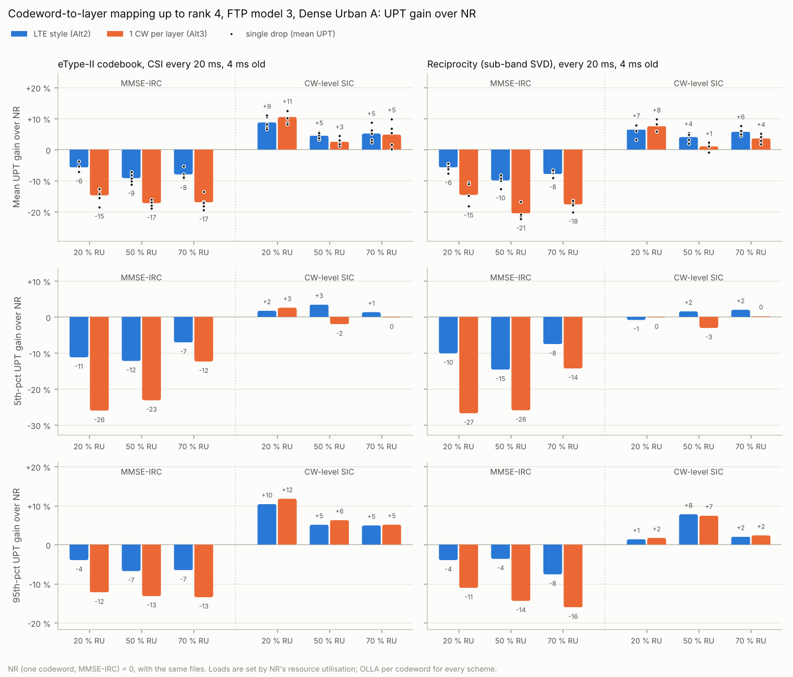

# Codeword-to-layer mapping up to rank 4 with FTP traffic

This is the FTP-traffic counterpart of [cw2lm-rank4.md](cw2lm-rank4.md). It fills the system-level part of the 6GR CW2L result-collection template (`6GR_DL_CW2L_template_v003.xlsx`, sheet "SLS rank 1-4"). It reports the mean, 5th-percentile and 95th-percentile user-perceived throughput (UPT) gain of the two multi-codeword mappings over NR at 20, 50 and 70 % resource utilisation (RU):

| Template row | Scheme (`cw_mapping`) | Layers per codeword at rank 1 / 2 / 3 / 4 |
|---|---|---|
| Alt1, same modulation order for all layers | NR (`nr`), the baseline | 1 / 2 / 3 / 4 |
| Alt2: 1 CW for rank 1, 2 CWs for rank 2-4 | LTE style (`lte`) | 1 / 1+1 / 1+2 / 2+2 |
| Alt3: 1 CW for rank 1, ..., 4 CWs for rank 4 | one codeword per layer (`per_layer`) | 1 / 1+1 / 1+1+1 / 1+1+1+1 |

Alt1 with a different modulation order per layer is not evaluated.

The same study at 20 MHz, 30 kHz SCS and 44 dBm, with 10 drops and loads that land on target, is in [cw2lm-ftp-20mhz.md](cw2lm-ftp-20mhz.md).

## Result



- **With MMSE-IRC, NR's single codeword is the best of the three at every load and percentile, and the losses are several times the full-buffer ones.**
  - LTE style loses 6–10 % mean UPT, 7–15 % at the 5th percentile and 4–8 % at the 95th.
  - One codeword per layer loses 15–21 % mean UPT, 12–27 % at the 5th percentile and 11–16 % at the 95th.
  - Every single drop has the same sign.
  - In the full-buffer study the same receiver lost 0.7–1.8 % cell SE.
- **With a codeword-level SIC receiver, more codewords gain.**
  - LTE style gains 4–9 % mean UPT, −1 to +4 % at the 5th percentile and +1 to +10 % at the 95th, and is ahead of NR in every drop.
  - One codeword per layer gains 1–11 % mean UPT, −3 to +3 % at the 5th percentile and +2 to +12 % at the 95th.
  - The gain is largest at 20 % RU (+6.5 to +10.5 %). There UEs are scheduled alone on the band with little interference, and SIC lifts the mean rank by 0.46–0.75.
  - This is with plain per-codeword OLLA. In the full-buffer study, OLLA that skips propagated SIC failures added 1.6–3.4 points of cell SE. That was not run here.
- **LTE style is the better multi-codeword split.** With SIC, it gains as much as one codeword per layer or more at 50 and 70 % RU, and it is ahead at the 5th percentile in four of the six cases and within a point in the other two. In mean UPT, one codeword per layer leads only at 20 % RU, by 1–2 points. With MMSE-IRC, one codeword per layer loses 2–2.6 times as much as LTE style. It also needs CQI, MCS and HARQ-ACK for up to four codewords instead of two.

So, up to rank 4 with a linear receiver, keep NR's single codeword. With a codeword-level SIC receiver, a two-codeword LTE-style split gives +4 to +9 % mean UPT, about neutral to +4 % at the cell edge. One codeword per layer adds nothing over it beyond a point or two at low load.

### Why bursty traffic magnifies the difference

All schemes serve the same files, so a scheme's RU measures how many resources it needs for the same bits. At 20 % RU every file completes and queueing is small. There, the UPT gain follows the RU almost one to one:

| eType-II / SVD, 20 % RU | RU vs NR | Mean UPT gain |
|---|---|---|
| MMSE-IRC, LTE style | +7.1 % / +7.1 % | −5.7 % / −5.7 % |
| MMSE-IRC, 1 CW per layer | +19.6 % / +20.4 % | −14.7 % / −14.5 % |
| SIC, LTE style | −5.3 % / −3.7 % | +8.8 % / +6.5 % |
| SIC, 1 CW per layer | −6.1 % / −3.6 % | +10.5 % / +7.6 % |

So the difference is mostly spectral efficiency, not queueing. The data point to three effects that full buffer does not have, or has much less of:

- **High ranks are common.** At 20 % RU, NR averages rank 2.8–3.1 against 2.3–2.7 at 70 % RU, so more transmissions carry three or four codewords. Rank 4 alone is 23 % (eType-II) and 37 % (SVD) of NR's transmissions at 20 % RU. In the full-buffer study, rank 4 was 2–7 %.
- **The per-codeword OLLA loops see few, bursty samples.** A UE is scheduled only while it has a file, and a codeword's loop updates only in transmissions that use it. The CQI is also measured under a different set of active interferers than the one that later transmits. The codewords on the weakest layers run far above the 10 % target: with one codeword per layer and MMSE-IRC at 20 % RU, codewords 3 and 4 have 21 % and 27 % first-transmission BLER (eType-II), against 13 % for NR's single codeword. With MMSE-IRC, the share of RBGs carrying retransmissions is 1.7–2.8 times NR's, for example 7.7 % against 3.0 %. NR's single codeword averages the layers in one TB, and one OLLA loop gets every sample.
- **A file waits for its last TB.** A file is complete only when every TB carrying it is acknowledged, and more codewords per slot means more TBs that can fail near the end. Each failure costs at least one 8-slot HARQ round trip. This effect is not separated from the others here.

At 50 and 70 % RU, queueing turns a few per cent of extra RU into a larger UPT loss: for example +2.3 % RU gives −7.9 % mean UPT for LTE style with MMSE-IRC (eType-II, 70 %).

### Limits

- **The 70 % point ran hotter than intended.** NR measured 18 / 55 / 78 % RU (eType-II) and 19 / 54 / 78 % (SVD) at the three loads. The arrival rates came from 900-slot NR runs on drop 0, which underestimated the build-up of backlog at the highest load in the 2300-slot runs. The 20 and 50 % points are within 5 points of their targets. All schemes ran with the same files, so the comparison is valid at the load NR actually saw.
- **Open files.** At the "70 %" point, 10–16 % of the counted files are still open at the end. Their UPT is an upper bound, so the schemes with more open files look better than they are. Those are MMSE-IRC with more codewords, so their losses at that load are, if anything, understated.
- **Other assumptions.**
  - Ideal channel estimation, MIESM link abstraction and SU-MIMO only.
  - Five drops of 2.3 s, with 1,443–4,661 counted files per scheme and load.
  - The spread of the single drops is in the tables below.

## Detailed results

### Gains over NR

**eType-II codebook**, gain in % over NR (mean / 5th pct / 95th pct UPT):

| Receiver | Scheme | 20 % RU: mean | 5th | 95th | 50 % RU: mean | 5th | 95th | 70 % RU: mean | 5th | 95th |
|---|---|---|---|---|---|---|---|---|---|---|
| MMSE-IRC | LTE style (Alt2) | **−5.7** | −11.2 | −3.9 | **−9.1** | −12.2 | −6.7 | **−7.9** | −7.1 | −6.5 |
| MMSE-IRC | 1 CW per layer (Alt3) | **−14.7** | −26.0 | −12.2 | **−17.2** | −23.1 | −13.1 | **−17.0** | −12.3 | −13.4 |
| CW-level SIC | LTE style (Alt2) | **+8.8** | +1.8 | +10.4 | **+4.6** | +3.5 | +5.1 | **+5.2** | +1.4 | +4.9 |
| CW-level SIC | 1 CW per layer (Alt3) | **+10.5** | +2.6 | +11.8 | **+2.6** | −2.0 | +6.3 | **+4.9** | −0.1 | +5.1 |

**Reciprocity (sub-band SVD)**, gain in % over NR (mean / 5th pct / 95th pct UPT):

| Receiver | Scheme | 20 % RU: mean | 5th | 95th | 50 % RU: mean | 5th | 95th | 70 % RU: mean | 5th | 95th |
|---|---|---|---|---|---|---|---|---|---|---|
| MMSE-IRC | LTE style (Alt2) | **−5.7** | −10.1 | −3.9 | **−9.9** | −14.6 | −3.6 | **−7.8** | −7.5 | −7.6 |
| MMSE-IRC | 1 CW per layer (Alt3) | **−14.5** | −26.7 | −11.1 | **−20.5** | −25.9 | −14.4 | **−17.6** | −14.3 | −16.1 |
| CW-level SIC | LTE style (Alt2) | **+6.5** | −0.8 | +1.4 | **+4.1** | +1.6 | +7.8 | **+5.8** | +2.0 | +2.1 |
| CW-level SIC | 1 CW per layer (Alt3) | **+7.6** | −0.1 | +1.8 | **+1.1** | −3.0 | +7.5 | **+3.7** | +0.3 | +2.4 |

### Spread over drops (mean UPT gain, min to max of the single drops)

| Receiver | Scheme | eType-II codebook, 20 % | eType-II codebook, 50 % | eType-II codebook, 70 % | Reciprocity (sub-band SVD), 20 % | Reciprocity (sub-band SVD), 50 % | Reciprocity (sub-band SVD), 70 % |
|---|---|---|---|---|---|---|---|
| MMSE-IRC | LTE style (Alt2) | −7 to −4 | −11 to −7 | −9 to −5 | −8 to −4 | −13 to −8 | −9 to −7 |
| MMSE-IRC | 1 CW per layer (Alt3) | −19 to −13 | −19 to −16 | −19 to −13 | −18 to −10 | −22 to −17 | −20 to −16 |
| CW-level SIC | LTE style (Alt2) | +7 to +11 | +3 to +6 | +2 to +9 | +3 to +8 | +2 to +5 | +5 to +8 |
| CW-level SIC | 1 CW per layer (Alt3) | +8 to +13 | +1 to +4 | +0 to +10 | +6 to +10 | −1 to +2 | +2 to +5 |

### NR baseline

| Precoding | Load | RU | Files (open) | UPT mean | 5th | median | 95th [Mbit/s] | BLER | Mean rank |
|---|---|---|---|---|---|---|---|---|---|
| eType-II codebook | 20 % | 18 % | 1443 (0) | 72.0 | 27.3 | 64.9 | 144.9 | 0.128 | 2.83 |
| eType-II codebook | 50 % | 55 % | 3267 (42) | 34.5 | 7.0 | 27.2 | 84.1 | 0.112 | 2.35 |
| eType-II codebook | 70 % | 78 % | 4572 (538) | 20.8 | 3.8 | 13.9 | 62.6 | 0.109 | 2.27 |
| Reciprocity (sub-band SVD) | 20 % | 19 % | 1563 (0) | 74.6 | 25.3 | 65.3 | 160.9 | 0.130 | 3.09 |
| Reciprocity (sub-band SVD) | 50 % | 54 % | 3387 (65) | 37.9 | 7.4 | 29.7 | 93.4 | 0.116 | 2.79 |
| Reciprocity (sub-band SVD) | 70 % | 78 % | 4661 (508) | 21.3 | 3.8 | 13.7 | 66.5 | 0.111 | 2.71 |

### Behaviour per scheme

| Precoding | Load | Receiver | Scheme | RU | Open files | First-tx BLER per CW | Mean rank | Rank 3 / 4 share | RBGs with retx |
|---|---|---|---|---|---|---|---|---|---|
| eType-II codebook | 20 % | MMSE-IRC | NR (Alt1) | 18 % | 0.0 % | 13 % | 2.83 | 37 / 23 % | 3.0 % |
| eType-II codebook | 20 % | MMSE-IRC | LTE style (Alt2) | 20 % | 0.0 % | 15 / 15 % | 2.95 | 32 / 31 % | 5.1 % |
| eType-II codebook | 20 % | MMSE-IRC | 1 CW per layer (Alt3) | 22 % | 0.0 % | 16 / 17 / 21 / 27 % | 2.87 | 37 / 26 % | 7.7 % |
| eType-II codebook | 20 % | CW-level SIC | LTE style (Alt2) | 17 % | 0.0 % | 15 / 15 % | 3.36 | 29 / 54 % | 3.6 % |
| eType-II codebook | 20 % | CW-level SIC | 1 CW per layer (Alt3) | 17 % | 0.0 % | 15 / 15 / 16 / 18 % | 3.58 | 23 / 68 % | 4.3 % |
| eType-II codebook | 50 % | MMSE-IRC | NR (Alt1) | 55 % | 1.3 % | 11 % | 2.35 | 28 / 4 % | 6.4 % |
| eType-II codebook | 50 % | MMSE-IRC | LTE style (Alt2) | 58 % | 2.5 % | 12 / 12 % | 2.40 | 25 / 8 % | 11.6 % |
| eType-II codebook | 50 % | MMSE-IRC | 1 CW per layer (Alt3) | 61 % | 3.8 % | 13 / 12 / 17 / 26 % | 2.39 | 29 / 6 % | 15.0 % |
| eType-II codebook | 50 % | CW-level SIC | LTE style (Alt2) | 54 % | 1.0 % | 12 / 12 % | 2.80 | 38 / 21 % | 8.8 % |
| eType-II codebook | 50 % | CW-level SIC | 1 CW per layer (Alt3) | 55 % | 1.4 % | 12 / 12 / 13 / 16 % | 3.10 | 38 / 36 % | 10.4 % |
| eType-II codebook | 70 % | MMSE-IRC | NR (Alt1) | 78 % | 11.8 % | 11 % | 2.27 | 23 / 2 % | 7.9 % |
| eType-II codebook | 70 % | MMSE-IRC | LTE style (Alt2) | 80 % | 13.5 % | 11 / 11 % | 2.29 | 21 / 5 % | 14.4 % |
| eType-II codebook | 70 % | MMSE-IRC | 1 CW per layer (Alt3) | 82 % | 16.3 % | 12 / 11 / 15 / 25 % | 2.29 | 24 / 3 % | 18.2 % |
| eType-II codebook | 70 % | CW-level SIC | LTE style (Alt2) | 77 % | 11.1 % | 11 / 11 % | 2.65 | 36 / 14 % | 11.1 % |
| eType-II codebook | 70 % | CW-level SIC | 1 CW per layer (Alt3) | 78 % | 11.6 % | 11 / 11 / 12 / 14 % | 2.96 | 39 / 29 % | 13.1 % |
| Reciprocity (sub-band SVD) | 20 % | MMSE-IRC | NR (Alt1) | 19 % | 0.0 % | 13 % | 3.09 | 36 / 37 % | 3.2 % |
| Reciprocity (sub-band SVD) | 20 % | MMSE-IRC | LTE style (Alt2) | 21 % | 0.0 % | 16 / 15 % | 3.29 | 25 / 52 % | 5.6 % |
| Reciprocity (sub-band SVD) | 20 % | MMSE-IRC | 1 CW per layer (Alt3) | 23 % | 0.0 % | 18 / 18 / 20 / 21 % | 3.25 | 33 / 46 % | 8.8 % |
| Reciprocity (sub-band SVD) | 20 % | CW-level SIC | LTE style (Alt2) | 18 % | 0.0 % | 15 / 14 % | 3.55 | 24 / 66 % | 4.1 % |
| Reciprocity (sub-band SVD) | 20 % | CW-level SIC | 1 CW per layer (Alt3) | 18 % | 0.0 % | 15 / 15 / 15 / 14 % | 3.67 | 20 / 74 % | 4.9 % |
| Reciprocity (sub-band SVD) | 50 % | MMSE-IRC | NR (Alt1) | 54 % | 1.9 % | 12 % | 2.79 | 45 / 17 % | 6.6 % |
| Reciprocity (sub-band SVD) | 50 % | MMSE-IRC | LTE style (Alt2) | 58 % | 2.7 % | 13 / 12 % | 2.93 | 34 / 29 % | 12.6 % |
| Reciprocity (sub-band SVD) | 50 % | MMSE-IRC | 1 CW per layer (Alt3) | 61 % | 4.0 % | 14 / 13 / 15 / 16 % | 2.92 | 41 / 25 % | 17.8 % |
| Reciprocity (sub-band SVD) | 50 % | CW-level SIC | LTE style (Alt2) | 53 % | 1.8 % | 13 / 11 % | 3.19 | 36 / 42 % | 9.4 % |
| Reciprocity (sub-band SVD) | 50 % | CW-level SIC | 1 CW per layer (Alt3) | 55 % | 1.9 % | 14 / 13 / 12 / 12 % | 3.31 | 34 / 48 % | 12.1 % |
| Reciprocity (sub-band SVD) | 70 % | MMSE-IRC | NR (Alt1) | 78 % | 10.9 % | 11 % | 2.71 | 44 / 14 % | 8.1 % |
| Reciprocity (sub-band SVD) | 70 % | MMSE-IRC | LTE style (Alt2) | 80 % | 13.2 % | 12 / 11 % | 2.80 | 34 / 23 % | 15.4 % |
| Reciprocity (sub-band SVD) | 70 % | MMSE-IRC | 1 CW per layer (Alt3) | 82 % | 16.2 % | 13 / 12 / 13 / 14 % | 2.81 | 41 / 20 % | 20.9 % |
| Reciprocity (sub-band SVD) | 70 % | CW-level SIC | LTE style (Alt2) | 77 % | 9.9 % | 12 / 11 % | 3.04 | 37 / 33 % | 12.0 % |
| Reciprocity (sub-band SVD) | 70 % | CW-level SIC | 1 CW per layer (Alt3) | 78 % | 10.5 % | 13 / 12 / 11 / 11 % | 3.16 | 38 / 39 % | 15.2 % |

## Template

`examples/fill_cw2l_template.py` writes these results into the sheet "SLS rank 1-4":

- **Columns:** column D is the MMSE-IRC receiver and column E the codeword-level SIC receiver, both with OLLA per codeword.
- **Blocks:** eType-II goes in the "Type II codebook" block and sub-band SVD in the "Reciprocity based precoding" block.
- **Values:** gains are fractions shown as `0.0 %`, and the NR row (Alt1, same modulation order) is 0.
- **Left empty:** the Type I and "Other precoding scheme" blocks, and the rows for Alt1 with a different modulation order per layer.
- **Assumptions and remarks:** the assumption rows describe the set-up below. The remarks give the measured NR RU and the run lengths.
- **How it writes:** it reads the labels with openpyxl but writes by patching the sheet's XML. Only that sheet and `styles.xml` change, and every other part of the workbook is kept as it was (saving with openpyxl would expand the row styles and drop the document metadata).

## Set-up

What differs from the full-buffer study:

- **Traffic:** FTP model 3 (TR 36.814 A.2.1.3.2): 0.5 Mbyte files arrive at every UE as a Poisson process. UPT is the file size divided by the time from its arrival to the delivery of its last bit.
- **Loads:** the arrival rate of each load is the one that gives NR with MMSE-IRC 20, 50 or 70 % RU in that precoding case. The rates were interpolated from NR runs on drop 0 at five rates (`--calibrate`, `results/cw2lm_ftp_rates.json`). Every scheme runs with the same files, so the comparison is at equal offered traffic, and each scheme reports its own RU.
- **Precoding:**
  - eType-II codebook (the template's Type II block): Rel-16 eType-II, parameter combination 6, CSI every 20 ms and 4 ms old.
  - Reciprocity-based (the template's Reciprocity block): the unquantised sub-band SVD of the UE's whitened channel, also every 20 ms and 4 ms old. This emulates SRS on all four UE ports with ideal channel estimation and a known interference covariance. RI and the per-codeword CQIs still come from the UE.
- **Receivers:** MMSE-IRC, and codeword-level MMSE-SIC with plain per-codeword OLLA (every NACK counts, including error propagation). With one codeword SIC is MMSE-IRC, so NR is the baseline for both.
- **Runs:** 5 drops (random streams `[1, 0..4]`, the same UE layouts as the full-buffer study), each 2.3 s.
  - The first 0.3 s are warm-up.
  - Files arriving in the last 0.5 s are served but not counted.
  - A counted file still open at the end counts with the upper bound size / (end − arrival), which keeps the slowest files in the lower tail.
  - Statistics pool all counted files of the 5 drops.

The rest is as in the full-buffer study: Dense Urban-eMBB A (57 cells, ISD 200 m, 4 GHz, 10 MHz at 15 kHz, 32T, UE 4R, 10 UEs per cell), rank ≤ 4, 4-PRB RBGs and sub-bands, OLLA per codeword (10 % target), up to 4 transmissions with chase combining and adaptive retransmissions.

**How FTP is modelled** (`FullBufferConfig.traffic = 'ftp3'`):

- **Scheduling:** only UEs with data are scheduled. PF assigns each RBG to the best UE among those whose buffer the RBGs given so far do not yet cover.
- **Data flow:** a new TB takes data from the UE's files first in first out, a TB larger than the buffer is padded, an ACK delivers its data, and a TB dropped after 4 transmissions gives its data back.
- **Interference:** cells and RBGs without data do not transmit. The interference of the cells beyond the 8 explicit interferers scales with the share of cells using each RBG.
- **Channels:** computed only for the UEs decoded in a slot, and for all UEs at CSI occasions, which makes a low-load slot several times cheaper than a full-buffer one.
- **Full-buffer path:** unchanged, bit-identical on 28 fixed-seed configurations.

## Running it

```bash
python examples/cw2lm_ftp_eval.py --calibrate --jobs 4          # arrival rates, ~35 min
python examples/cw2lm_ftp_eval.py --drops 5 --jobs 4            # 150 runs, ~40 h on 4 cores
python examples/cw2lm_ftp_eval.py --summary-only --log "$(ls results/ftp_parts/*.jsonl | paste -sd,)"
python examples/plot_cw2lm_ftp.py
python examples/fill_cw2l_template.py results/cw2lm_ftp.json 6GR_DL_CW2L_template_v003.xlsx
```

Each run takes 35–90 min. The study was run in slices of one precoding case, load and set of drops, in parallel cloud sessions and locally. The slice logs are in `results/ftp_parts/`, and `results/cw2lm_ftp.json` is the summary the tables are taken from.

- **The first round:** its background jobs were stopped by a 2-hour task limit after 106 of the 150 runs.
- **The rest:** the other 44 runs went to new jobs sized to finish within the limit. The runner skips runs already logged.
- **Containers:** as a result, 23 of the 30 (case, load, drop) groups have their schemes spread over two containers. The UE layout and the files are the same in every container. Only the floating-point details of the linear algebra (OpenBLAS kernels differ between CPUs) can differ, so the comparison stays paired in layout and traffic.
- **Engine:** no engine or runner code changed between the two rounds.
