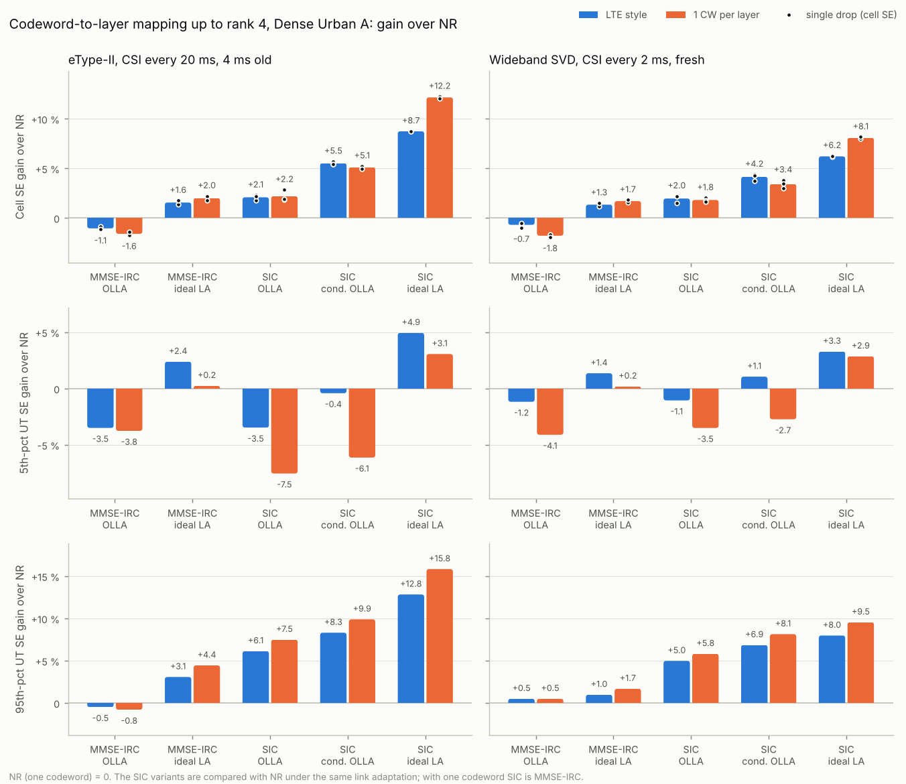

# Codeword-to-layer mapping up to rank 4: NR, LTE style, one codeword per layer

This evaluates three ways of mapping codewords to layers for SU-MIMO transmissions of rank 1 to 4, end to end in the Dense Urban A system:

| Scheme (`cw_mapping`) | Rank 1 | Rank 2 | Rank 3 | Rank 4 | Reference |
|---|---|---|---|---|---|
| **NR** (`nr` = `alt1`) | 1 | 2 | 3 | 4 | TS 38.211 Table 7.3.1.3-1 |
| **LTE style** (`lte` = `alt2`) | 1 | 1 + 1 | 1 + 2 | 2 + 2 | TS 36.211 Table 6.3.3.2-1 |
| **1 CW per layer** (`per_layer` = `alt3`) | 1 | 1 + 1 | 1 + 1 + 1 | 1 + 1 + 1 + 1 | |

The entries are the layers per codeword. Layers are in precoder-column order, which is strongest first for both the SVD and the eType-II precoders, so the LTE split puts the strongest layer alone on codeword 0 at rank 3. The module is the one described in [cw2lm-sls.md](cw2lm-sls.md). Each codeword has its own CQI, MCS, OLLA loop, TB and HARQ process, and the rank is chosen knowing the split. `nr`, `lte` and `per_layer` are names for its `alt1`, `alt2` and `alt3`.

The same mappings with FTP model 3 traffic at 20, 50 and 70 % resource utilisation are in [cw2lm-ftp.md](cw2lm-ftp.md).

## Result



- **With a linear (MMSE-IRC) receiver, NR's single codeword is the best of the three.** With OLLA, LTE style loses 0.7–1.1 % of cell SE and 1.2–3.5 % at the 5th percentile, and one codeword per layer loses 1.6–1.8 % and 3.8–4.1 %. Every drop has the same sign. The top UTs are unaffected (95th percentile −0.8 to +0.5 %).
- **A separate MCS per layer group is worth 1.3–2.0 %, and per-codeword link adaptation costs more than that.** With ideal link adaptation for every scheme, LTE style gains 1.3–1.6 % over NR and one codeword per layer 1.7–2.0 %. With OLLA they lose 2.0–3.6 points more than NR does: the codewords on the weakest layers run above the BLER target, and twice as many RBGs carry retransmissions.
- **A codeword-level SIC receiver is what makes more codewords pay.** SIC raises the reported rank: rank 4 goes from 2–7 % of transmissions for NR to 14–31 % with LTE style and 28–49 % with one codeword per layer. With ideal link adaptation, LTE style then gains 6.2–8.7 % and one codeword per layer 8.1–12.2 %, at every geometry.
- **How much of that survives depends on how OLLA treats error propagation.** When a codeword fails, the later codewords of the transmission fail too, 62 % of the time against 5 % otherwise. Per-codeword OLLA that counts those NACKs drives the later codewords' MCS down and keeps only about 2 % cell SE. OLLA that skips a codeword's update when an earlier codeword failed (the gNB has every codeword's ACK/NACK) keeps 4.2–5.5 % (LTE style) and 3.4–5.1 % (one codeword per layer).
- **LTE style is the better multi-codeword split.** With realistic link adaptation, it gains as much cell SE as one codeword per layer, or more. It is neutral at the 5th percentile (−0.4 / +1.1 % with conditional OLLA), where one codeword per layer loses 2.7–6.1 %. It also needs CQI, MCS and HARQ-ACK for two codewords instead of up to four. One codeword per layer leads in cell SE only with ideal link adaptation. With SIC it leads at the 95th percentile under every link adaptation: +8.1 to +9.9 % against +6.9 to +8.3 % for LTE style with conditional OLLA. It trades cell-edge throughput for peak throughput.

So, up to rank 4 with a linear receiver, keep NR's single codeword. A two-codeword LTE-style split pays only with a SIC receiver, and then only with link adaptation that knows about error propagation: about +4 to +5.5 % cell SE, against +6 to +9 % with ideal link adaptation. One codeword per layer adds nothing over LTE style unless link adaptation is close to ideal, and it costs the most at the cell edge.

```bash
python examples/cw2lm_rank4_eval.py --variants irc-olla --drops 3 --jobs 4       # ~2 h on 4 cores
python examples/cw2lm_rank4_eval.py --variants sic-olla,sic-olla-cond --schemes lte,per_layer --drops 3 --jobs 4
python examples/cw2lm_rank4_eval.py --variants irc-ideal,sic-ideal --drops 2 --slots 240 --warmup 80 --jobs 4
python examples/cw2lm_rank4_eval.py --summary-only --plot results/cw2lm_rank4.png
python examples/cw2lm_sic_error_propagation.py                                 # ~10 min
```

Every finished drop is appended to `results/cw2lm_rank4_runs.jsonl`, together with the commit that produced it and the per-UT SE, and a re-run skips the drops already logged. `results/cw2lm_rank4.json` holds the summary that the tables below are taken from.

## What this adds to the earlier study

The earlier study ([cw2lm-sls.md](cw2lm-sls.md)) ran its main table with 160 slots per drop, where the OLLA loops had not settled: even NR ran at 15–16 % first-transmission BLER against a 10 % target. Its converged check (480 slots) covered one drop, NR and one codeword per layer only. This evaluation:

- runs **all three schemes with converged OLLA** (480 slots, 160 of them warm-up) on three drops, so LTE style is evaluated converged for the first time;
- adds an **ideal link adaptation** reference, which separates what a mapping could gain from what per-codeword link adaptation costs;
- adds a **codeword-level SIC receiver**, the receiver multi-codeword transmission was designed for in LTE, with two OLLA policies. With MMSE-IRC, the only lever more codewords have is a separate MCS per layer group.

## Set-up

- Dense Urban-eMBB A preset: 19 sites × 3, ISD 200 m, 4 GHz, 10 MHz at 15 kHz, 32T (8,8,2;2,8), UT (1,2,2) with 4 receive ports, 10 UTs per cell (570 UTs), 80 % indoor at 3 km/h and 20 % in car at 30 km/h.
- Building loss: 20 % high-loss / 80 % low-loss buildings, the `du-a` preset at the time. Since 2026-11-03 `du-a` uses the ITU-R M.2412 channel-model-A loss (20 dB + 0.5 d2D-in); `examples/cw2lm_rank4_eval.py` pins the former mix (`DU_A_MIXED_O2I`) so these results stay reproducible. Geometry differs by 0–0.3 dB between the two in the Dense Urban calibration ([benchmark-suite.md](benchmark-suite.md)).
- SU-MIMO up to rank 4, full buffer, PF scheduling, RBG = CSI sub-band = 4 PRB, 2 PDCCH symbols and 9 overhead REs per PRB, channel updated every 2 slots.
- Two CSI cases, as in the earlier study: **eType-II** (combination 6) every 20 ms and 4 ms old (Apple-like), and unquantised **wideband SVD** every 2 ms and fresh (Nokia-like).
- OLLA per UT and codeword (10 % BLER target, 0.5 dB step). Up to 4 transmissions with chase combining, 8-slot RTT. Retransmissions are **adaptive**: they are re-precoded with the UT's current report when its rank matches, and refilled codewords take its current CQI. This was the better policy for every scheme in the earlier study, and the better case for more codewords.
- Same drops (random stream `[1, i]`) for every configuration. Gains are against NR on the same drops.

| Variant | Receiver | Link adaptation | Runs |
|---|---|---|---|
| `irc-olla` | MMSE-IRC | OLLA per codeword | 3 drops × 480 slots (160 warm-up) |
| `irc-ideal` | MMSE-IRC | ideal | 2 drops × 240 slots (80 warm-up) |
| `sic-olla` | codeword-level MMSE-SIC | OLLA per codeword | 3 drops × 480 slots (160 warm-up) |
| `sic-olla-cond` | codeword-level MMSE-SIC | OLLA per codeword, not updated when an earlier codeword failed | 3 drops × 480 slots (160 warm-up) |
| `sic-ideal` | codeword-level MMSE-SIC | ideal | 2 drops × 240 slots (80 warm-up) |

With one codeword, SIC is MMSE-IRC and both OLLA policies are the same. NR is therefore run with MMSE-IRC only, and every SIC variant is compared with it under the same kind of link adaptation (OLLA or ideal). Ideal link adaptation has no loop to converge, so its runs are shorter.

## The references

**Ideal link adaptation** (`FullBufferConfig.ideal_la`). Every new TB, including a codeword refilled in a retransmission slot, takes the highest MCS whose BLER meets the 10 % target on the per-layer SINR it actually gets in that slot. The SINR is computed with the decoder's own MIESM and waterfall, so the MCS has no prediction error. With SIC, the MCS is chosen on the SINR after the earlier codewords of the transmission are cancelled. The transmitter cannot know whether they will decode, so error propagation hits this reference too. CSI, rank, precoder and scheduling are unchanged. With a steep waterfall and discrete MCSs, the highest MCS meeting 10 % typically decodes at a few per cent BLER. The reference therefore runs at a lower BLER than OLLA, for every scheme alike.

**Codeword-level SIC** (`FullBufferConfig.receiver = 'sic'`). The UT decodes the codewords of a transmission in index order, which is strongest layers first. After each codeword that decodes, it cancels that codeword's layers before computing the MMSE-IRC SINR of the remaining layers. Cancellation is ideal, but error propagation is kept: a codeword that fails is not cancelled, and its layers stay as interference for the later codewords. The CSI report assumes the earlier codewords are cancelled when it computes each codeword's CQI, so CQI and RI see the SIC gain. With chase combining, every attempt adds the SINR it got after cancellation.

**OLLA with SIC** (`FullBufferConfig.olla_sic_conditional`). The later codewords' CQIs assume the earlier ones decode. When an earlier codeword fails, a later one usually fails too. In one SVD drop with LTE style and SIC (`examples/cw2lm_sic_error_propagation.py`, 200 slots), codeword 1's first transmissions fail 62 % of the time after codeword 0 failed (5,273 TBs), against 5.4 % when codeword 0 decoded (38,577 TBs). Plain per-codeword OLLA counts all those NACKs, so to hold 10 % overall it pushes codeword 1 to about 5 % BLER in the transmissions where its CQI applies. That is a margin the CQI did not ask for. With `olla_sic_conditional` a codeword's loop is not updated in a transmission whose earlier codeword failed. The later codewords' loops then aim at 10 % BLER when the earlier ones decode, and the codewords run above that overall: 16–17 % for codeword 1, and up to 31–34 % for codeword 4. This needs nothing new from the UT: the gNB receives every codeword's ACK/NACK.

## Results

### Gains over NR

Gain in per cent over NR, for cell SE and for the 5th-percentile, median and 95th-percentile UT SE. With full buffer and 10 UTs in every cell, cell SE is 10 × the mean UT SE, so the cell-SE gain is also the gain in mean user throughput:

| Receiver, link adaptation | Scheme | eType-II: cell SE | 5th pct | median | 95th pct | SVD: cell SE | 5th pct | median | 95th pct |
|---|---|---|---|---|---|---|---|---|---|
| MMSE-IRC, OLLA | LTE style | **−1.1** | −3.5 | −1.8 | −0.5 | **−0.7** | −1.2 | −1.3 | +0.5 |
| MMSE-IRC, OLLA | 1 CW per layer | **−1.6** | −3.8 | −2.0 | −0.8 | **−1.8** | −4.1 | −2.6 | +0.5 |
| MMSE-IRC, ideal LA | LTE style | **+1.6** | +2.4 | +1.6 | +3.1 | **+1.3** | +1.4 | +1.4 | +1.0 |
| MMSE-IRC, ideal LA | 1 CW per layer | **+2.0** | +0.2 | +0.7 | +4.4 | **+1.7** | +0.2 | +1.6 | +1.7 |
| SIC, OLLA | LTE style | **+2.1** | −3.5 | +0.3 | +6.1 | **+2.0** | −1.1 | +0.4 | +5.0 |
| SIC, OLLA | 1 CW per layer | **+2.2** | −7.5 | +0.3 | +7.5 | **+1.8** | −3.5 | −0.2 | +5.8 |
| SIC, conditional OLLA | LTE style | **+5.5** | −0.4 | +3.5 | +8.3 | **+4.2** | +1.1 | +2.3 | +6.9 |
| SIC, conditional OLLA | 1 CW per layer | **+5.1** | −6.1 | +2.1 | +9.9 | **+3.4** | −2.7 | +1.3 | +8.1 |
| SIC, ideal LA | LTE style | **+8.7** | +4.9 | +7.4 | +12.8 | **+6.2** | +3.3 | +5.7 | +8.0 |
| SIC, ideal LA | 1 CW per layer | **+12.2** | +3.1 | +10.0 | +15.8 | **+8.1** | +2.9 | +6.4 | +9.5 |

NR itself, with OLLA (480 slots), has these cell SE / 5th-pct / median / 95th-pct UT SE values, in bit/s/Hz (× 10 MHz gives the user throughput), and first-transmission BLER:

- eType-II: 4.59 / 0.198 / 0.413 / 0.876, BLER 0.103
- SVD: 5.01 / 0.204 / 0.445 / 0.957, BLER 0.101

With ideal link adaptation (240 slots) they are:

- eType-II: 5.61 / 0.244 / 0.504 / 1.047, BLER 0.033
- SVD: 6.16 / 0.255 / 0.545 / 1.169, BLER 0.034

Per drop, each cell-SE gain is within 1 point of the pooled value, and the sign never changes between drops. For example, LTE style with MMSE-IRC and OLLA gives −1.2 / −0.9 / −1.1 % on the three eType-II drops, and LTE style with conditional OLLA gives +5.7 / +5.4 / +5.4 %. The dots in the figure are the single drops.

The percentiles are noisier, the 95th most of all, since each drop's value rests on the top 28 of 570 UTs. Between drops, the 95th-percentile gain typically moves by 3 points and by up to 6. Read differences of a couple of points there as a tendency, not a result. That includes one codeword per layer being 1–3 points ahead of LTE style at the 95th percentile with SIC. It is ahead in every pooled SIC configuration and in 13 of the 16 single drops.

### Potential against link adaptation

The ideal-LA gain is what a mapping could give with an exact MCS. The OLLA gain is what is left with realistic link adaptation, and the difference is what the scheme loses to link adaptation beyond what NR loses:

| CSI | Receiver, link adaptation | Scheme | Gain, ideal LA | Gain, OLLA | Lost to OLLA [points] | Share kept |
|---|---|---|---|---|---|---|
| eType-II | MMSE-IRC, OLLA | LTE style | +1.6 % | −1.1 % | 2.6 | – |
| | | 1 CW per layer | +2.0 % | −1.6 % | 3.6 | – |
| | SIC, OLLA | LTE style | +8.7 % | +2.1 % | 6.7 | 24 % |
| | | 1 CW per layer | +12.2 % | +2.2 % | 10.0 | 18 % |
| | SIC, conditional OLLA | LTE style | +8.7 % | +5.5 % | 3.2 | 63 % |
| | | 1 CW per layer | +12.2 % | +5.1 % | 7.0 | 42 % |
| SVD | MMSE-IRC, OLLA | LTE style | +1.3 % | −0.7 % | 2.0 | – |
| | | 1 CW per layer | +1.7 % | −1.8 % | 3.5 | – |
| | SIC, OLLA | LTE style | +6.2 % | +2.0 % | 4.3 | 32 % |
| | | 1 CW per layer | +8.1 % | +1.8 % | 6.3 | 22 % |
| | SIC, conditional OLLA | LTE style | +6.2 % | +4.2 % | 2.1 | 67 % |
| | | 1 CW per layer | +8.1 % | +3.4 % | 4.7 | 42 % |

- **With MMSE-IRC, the potential is small and OLLA costs more than it.** One codeword coded across all layers loses little against a separate MCS per layer group: whether it decodes depends on the mutual information averaged over its layers (MIESM), not on the weakest layer. The ideal-LA potential, +1.3 to +2.0 %, is a little above the probe's CSI-stage estimate of +0.3 to +1.2 % ([cw2lm-sls-probe.md](cw2lm-sls-probe.md)). Per-codeword OLLA loses 2.0–3.6 points of it, for the reasons found in the earlier study. Each codeword sees its layers' SINR prediction error in full instead of averaged over all layers. The loops of codewords 3 and 4 move only at ranks 3 and 4. A transmission needs a retransmission slot whenever any of its codewords fails.
- **With SIC, the potential is large and the OLLA policy decides how much is kept.** Plain OLLA keeps a fifth to a third, conditional OLLA two thirds for LTE style and two fifths for one codeword per layer.
- **One codeword per layer has the most potential and loses the most to link adaptation.** Each extra codeword adds another loop, another source of error propagation and another reason for a retransmission slot.

### Rank, BLER and retransmissions

With OLLA (480 slots):

| CSI | Receiver, link adaptation | Scheme | Rank 1 / 2 / 3 / 4 [%] | Mean rank | First-tx BLER per codeword | RBGs with a retransmission | Mean MCS |
|---|---|---|---|---|---|---|---|
| eType-II | MMSE-IRC, OLLA | NR | 1 / 76 / 22 / 2 | 2.25 | 0.103 | 8.8 % | 15.0 |
| | | LTE style | 1 / 76 / 20 / 4 | 2.27 | 0.107, 0.103 | 15.7 % | 14.7 |
| | | 1 CW per layer | 1 / 74 / 22 / 3 | 2.27 | 0.109, 0.105, 0.135, 0.174 | 18.3 % | 14.4 |
| | SIC, OLLA | LTE style | 0 / 48 / 37 / 14 | 2.66 | 0.109, 0.104 | 13.1 % | 13.2 |
| | | 1 CW per layer | 0 / 30 / 38 / 32 | 3.01 | 0.108, 0.105, 0.111, 0.127 | 16.5 % | 11.4 |
| | SIC, conditional OLLA | LTE style | 0 / 49 / 37 / 14 | 2.65 | 0.109, 0.174 | 18.5 % | 14.0 |
| | | 1 CW per layer | 0 / 33 / 38 / 28 | 2.95 | 0.109, 0.171, 0.251, 0.341 | 28.6 % | 12.7 |
| SVD | MMSE-IRC, OLLA | NR | 1 / 51 / 42 / 7 | 2.54 | 0.101 | 8.1 % | 14.4 |
| | | LTE style | 1 / 53 / 36 / 10 | 2.56 | 0.102, 0.103 | 14.3 % | 14.3 |
| | | 1 CW per layer | 1 / 51 / 40 / 8 | 2.55 | 0.102, 0.103, 0.118, 0.169 | 18.7 % | 13.7 |
| | SIC, OLLA | LTE style | 0 / 31 / 38 / 31 | 3.00 | 0.102, 0.103 | 11.7 % | 12.6 |
| | | 1 CW per layer | 0 / 19 / 32 / 49 | 3.29 | 0.102, 0.103, 0.106, 0.114 | 16.1 % | 11.1 |
| | SIC, conditional OLLA | LTE style | 0 / 31 / 38 / 31 | 2.99 | 0.102, 0.168 | 16.6 % | 13.2 |
| | | 1 CW per layer | 0 / 21 / 33 / 46 | 3.25 | 0.103, 0.161, 0.228, 0.309 | 29.0 % | 12.2 |

With ideal link adaptation (240 slots):

| CSI | Receiver | Scheme | Rank 1 / 2 / 3 / 4 [%] | First-tx BLER per codeword | RBGs with a retransmission |
|---|---|---|---|---|---|
| eType-II | MMSE-IRC | NR | 1 / 76 / 21 / 2 | 0.033 | 3.2 % |
| | | LTE style | 1 / 75 / 20 / 4 | 0.033, 0.035 | 6.4 % |
| | | 1 CW per layer | 1 / 73 / 23 / 3 | 0.034, 0.036, 0.039, 0.042 | 7.7 % |
| | SIC | LTE style | 0 / 49 / 36 / 15 | 0.035, 0.057 | 6.7 % |
| | | 1 CW per layer | 0 / 31 / 38 / 31 | 0.037, 0.057, 0.088, 0.115 | 10.6 % |
| SVD | MMSE-IRC | NR | 1 / 51 / 41 / 7 | 0.034 | 3.2 % |
| | | LTE style | 1 / 53 / 36 / 11 | 0.033, 0.036 | 6.5 % |
| | | 1 CW per layer | 1 / 50 / 39 / 9 | 0.033, 0.036, 0.041, 0.040 | 8.7 % |
| | SIC | LTE style | 0 / 31 / 38 / 31 | 0.035, 0.057 | 6.8 % |
| | | 1 CW per layer | 0 / 19 / 31 / 49 | 0.037, 0.053, 0.080, 0.102 | 11.5 % |

- **With MMSE-IRC, the mapping barely moves the rank.** Codeword-aware RI shifts a few per cent of the transmissions from rank 3 to ranks 2 and 4. Three quarters of the eType-II transmissions and half of the SVD ones are rank 2, where LTE style and one codeword per layer are the same mapping.
- **With SIC, the rank goes up.** The CQI of a later codeword assumes the earlier ones are cancelled, so higher ranks report a higher sum rate. The mean rank rises from 2.25 to 2.65 (LTE style) and 3.0 (one codeword per layer) with eType-II, and from 2.54 to 3.0 and 3.3 with SVD. The rank is decided by the CSI, so it is nearly the same with OLLA and with ideal link adaptation. Those extra layers pay for themselves only when the MCS is right.
- **Error propagation shows in the BLER of the later codewords.** With ideal link adaptation, codeword 0 decodes at 3.5 % BLER as for NR. The later codewords, whose MCS assumes the earlier ones decode, fail at 5–6 % (codeword 1) and up to 10–12 % (codeword 4). Plain OLLA pins every codeword at 10 % overall, while conditional OLLA lets the later ones run at 16–17 % (codeword 1) to 31–34 % (codeword 4).
- **Retransmission slots grow with the number of codewords.** With MMSE-IRC and OLLA, the share of RBGs carrying a retransmission goes from 8–9 % (NR) to 14–16 % (LTE style) and 18–19 % (one codeword per layer). With SIC and conditional OLLA it is 17–19 % for LTE style and 29 % for one codeword per layer.

### Where the gain lands: geometry

Gain in the mean UT SE of each third of the UTs, sorted by geometry (wideband SINR):

| Receiver, link adaptation | Scheme | eType-II: lowest | middle | highest | SVD: lowest | middle | highest |
|---|---|---|---|---|---|---|---|
| MMSE-IRC, OLLA | LTE style | −2.0 | −2.0 | +0.1 | −1.8 | −1.5 | +0.4 |
| | 1 CW per layer | −3.3 | −2.6 | −0.0 | −3.3 | −2.9 | −0.2 |
| MMSE-IRC, ideal LA | LTE style | +0.8 | +0.9 | +2.4 | +0.8 | +0.5 | +2.2 |
| | 1 CW per layer | +0.7 | +1.0 | +3.4 | +0.5 | +0.9 | +2.9 |
| SIC, OLLA | LTE style | −2.3 | +0.1 | +5.7 | −1.5 | +0.6 | +4.6 |
| | 1 CW per layer | −5.3 | −0.1 | +7.7 | −3.8 | +0.4 | +5.5 |
| SIC, conditional OLLA | LTE style | +1.3 | +3.4 | +9.2 | +0.4 | +2.7 | +7.0 |
| | 1 CW per layer | −2.4 | +2.6 | +10.7 | −2.5 | +1.9 | +7.4 |
| SIC, ideal LA | LTE style | +3.9 | +6.5 | +12.8 | +2.6 | +4.9 | +8.9 |
| | 1 CW per layer | +3.6 | +9.8 | +18.2 | +2.5 | +6.6 | +11.8 |

The gain of more codewords is a high-geometry gain: those UTs have the SINR for rank 3 and 4, and SIC turns it into rate. At low geometry a codeword fails more often, and with SIC it takes the later codewords with it. With realistic link adaptation, one codeword per layer therefore loses 2.4–5.3 % in the lowest third with SIC. LTE style, with one codeword fewer to fail, is neutral to positive there with conditional OLLA. At the top of the distribution it is the other way round. With SIC, the 95th-percentile UTs gain 5–16 %, more than the average, and one codeword per layer gains most there.

## Reproducibility

- **SVD case:** drop 0 of NR and of one codeword per layer (MMSE-IRC, OLLA, 480 slots) reproduces the earlier converged run, `results/cw2lm_sls_long.json`, to the last digit: 5.0922 and 5.0029 bit/s/Hz.
- **eType-II case:** the same drop is 0.4 % off. NR gives 4.681 against 4.663 and one codeword per layer 4.602 against 4.605. A run is deterministic on one machine, but OpenBLAS picks its kernels by CPU. Forcing another kernel (`OPENBLAS_CORETYPE=Haswell`) changes a short eType-II drop by 0.7 %. The eType-II codebook search makes discrete choices that floating-point differences in the last bits can flip, and the drop then evolves differently. The SVD runs were not affected.
- **What this means here:** all comparisons in this study come from one machine and are paired by drop. The per-drop spread of the gains, up to 1 point, is the uncertainty to read them with.
- **Code changes during the study:** the drops were run from four commits, and the log records which. Each later addition (SIC and ideal LA, the ideal-LA fix, conditional OLLA) left the earlier variants' paths unchanged. With the default settings the engine is bit-identical to the version before this study (checked on 31 fixed-seed configurations). The SIC ideal-LA drops were rerun after a fix. Their MCS had been chosen knowing whether the earlier codewords decoded in that slot, which a transmitter cannot know. The fix lowered their gains by 1–2 points (`tests/test_cw_mapping.py` checks it).

## Limitations

- **Scope:** one scenario (Dense Urban A, 10 MHz, 32T, 4-port UTs), full buffer, and 3 drops (OLLA) or 2 drops (ideal link adaptation). Light load, FTP traffic and other antenna configurations are not covered.
- **Link abstraction:** MIESM with AWGN waterfalls; SIC has not been checked against a link-level simulation.
- **SIC model:**
  - cancellation is ideal, with no channel-estimation error in the reconstruction;
  - the decoding order is fixed (codeword index, which is strongest layers first);
  - cancellation is per codeword, not symbol-level.
- **NR baseline receiver:** NR's single codeword is decoded with a linear MMSE-IRC receiver. A near-ML receiver for the single codeword, the usual answer to SIC in NR, would narrow the gap, and it is not modelled.
- **Signalling overhead of extra codewords is not charged:**
  - CQI for each codeword in the CSI report;
  - HARQ-ACK bits for each codeword;
  - MCS, NDI and RV for each codeword in the DCI (NR's DCI format 1_1 has second-TB fields only when two codewords are configured, which NR needs only above 4 layers).
  This favours one codeword per layer most.
- **OLLA:** 10 % target and 0.5 dB step for every codeword. Per-rank loops (`olla_per_rank`) and other targets for the later codewords are not explored. Conditional OLLA is one simple policy; schemes that adapt the later codewords' target, or predict error propagation, could keep more of the SIC gain.
- **CQI:** the per-codeword CQIs carry the 3–4 dB per-layer prediction error found by the probe. Better SINR prediction, for example with interference prediction, would shrink the link-adaptation cost for every scheme, most of all for one codeword per layer.
